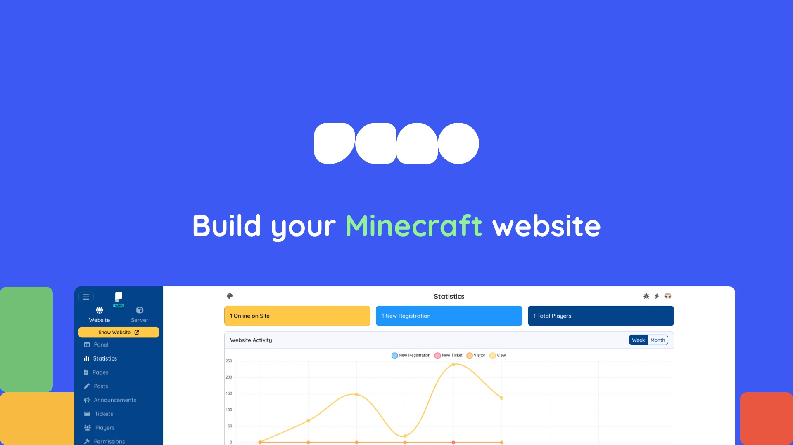
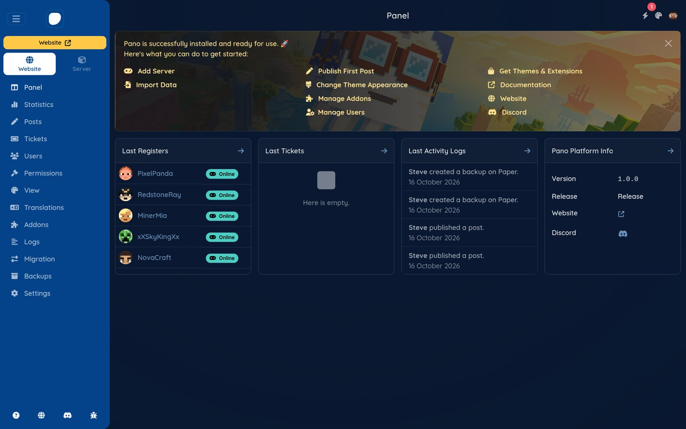
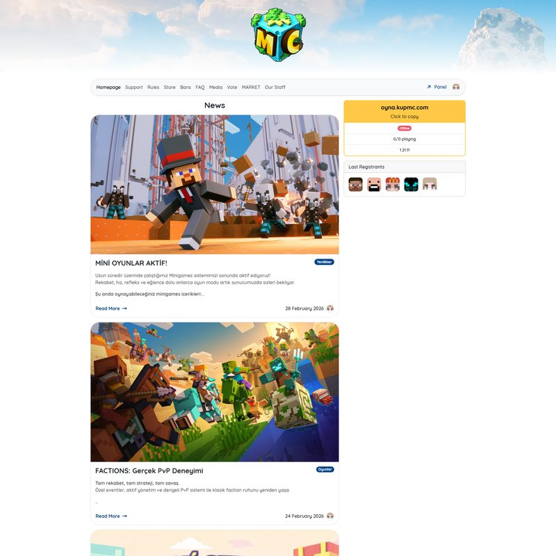
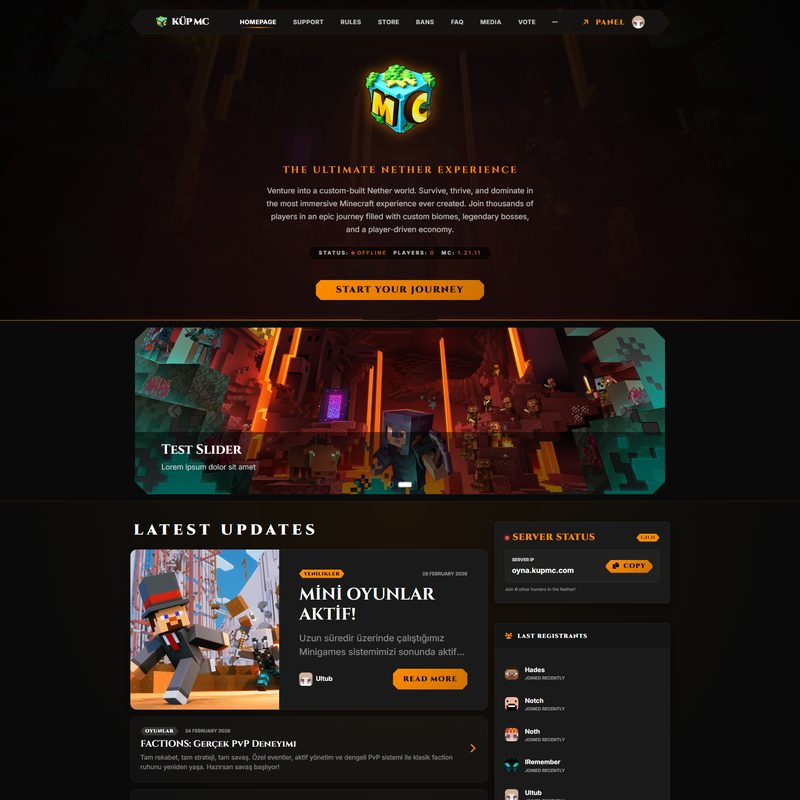
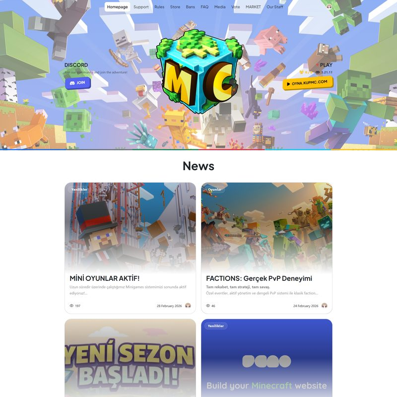

<h1 align="center">Pano</h1>

<h3 align="center">Build your Minecraft server panel</h3>

<p align="center">
  One place for your website, store, and game server.<br>
  An open-source CMS and management panel you can extend with themes and addons.
</p>

<p align="center">
  <a href="https://demo.panomc.com"></a>
  <a href="https://panomc.com"></a>
</p>

<p align="center">
  <a href="https://panomc.com/downloads"><b>Download</b></a> ·
  <a href="https://panomc.com/docs"><b>Docs</b></a> ·
  <a href="https://panomc.com/discord"><b>Discord</b></a>
</p>

<p align="center">
  <a href="https://github.com/PanoMC/pano/releases/latest"></a>
  <a href="https://panomc.com/discord"></a>
  <a href="https://github.com/PanoMC/pano/blob/main/LICENSE"></a>
</p>

<p align="center">
  
</p>

---

<h2 align="center">Your website and your servers, one panel</h2>

<p align="center">
  
  
</p>

---

<table>
  <tr>
    <td width="33%" valign="top">
      <h3>Ready in minutes</h3>
      One command installs everything. A setup wizard walks you through the rest.
    </td>
    <td width="33%" valign="top">
      <h3>Connected to your game</h3>
      Players, online status and staff come straight from your Minecraft server, live.
    </td>
    <td width="33%" valign="top">
      <h3>Grows with you</h3>
      Add a store, voting, bans, FAQ and more from the Pano market with a single click.
    </td>
  </tr>
</table>

---

<h2 align="center">Themes</h2>

<table>
  <tr>
    <td align="center" width="33%">
      <br>
      <b>Vanilla</b> · <code>Free</code>
    </td>
    <td align="center" width="33%">
      <br>
      <b>Blaze</b> · <code>Premium</code>
    </td>
    <td align="center" width="33%">
      <br>
      <b>Blocky</b> · <code>Premium</code>
    </td>
  </tr>
</table>

---

## Projects

| Project | What it is |
|---|---|
| [**pano**](https://github.com/PanoMC/pano) | The platform itself. Start here. |
| [**pano-mc-plugin**](https://github.com/PanoMC/pano-mc-plugin) | Connects your Minecraft server (Paper, Spigot, Folia, BungeeCord, Velocity, Fabric). |
| [**panel-ui**](https://github.com/PanoMC/panel-ui) | The management panel. |
| [**setup-ui**](https://github.com/PanoMC/setup-ui) | The setup wizard. |
| [**vanilla-theme**](https://github.com/PanoMC/vanilla-theme) | The free default theme. |
| [**docs**](https://github.com/PanoMC/docs) | The documentation. |

---

## Install Now

```powershell
# Windows
irm https://panomc.com/install.ps1 | iex
```

```bash
# macOS / Linux
curl -fsSL https://panomc.com/install | bash
```

More options on [panomc.com/downloads](https://panomc.com/downloads).

---

<p align="center">
  Made with 💙 for Minecraft communities · Open source projects here are licensed under GPLv3
</p>
