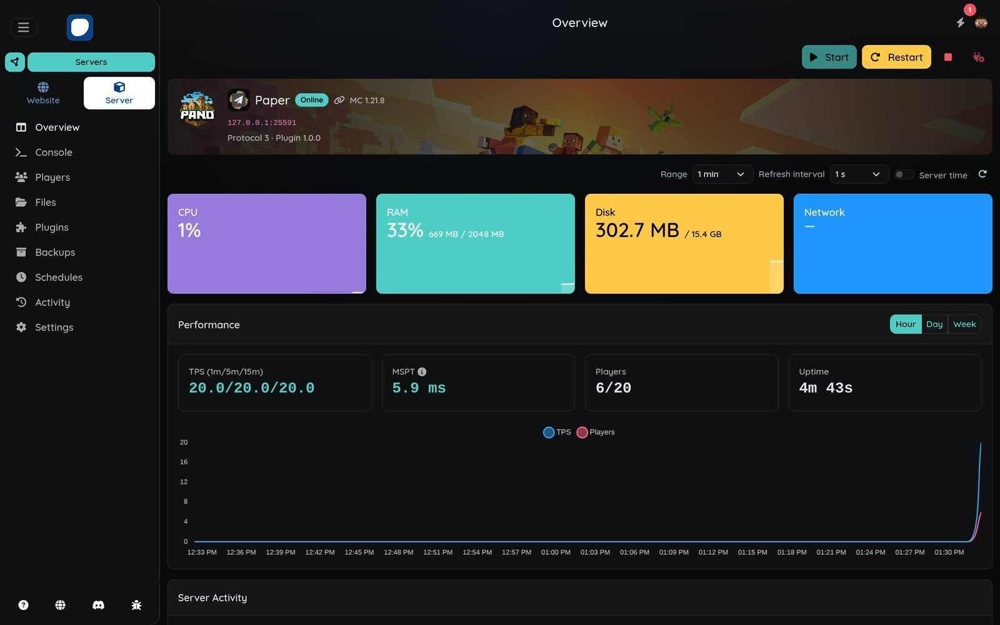

<p align="center">
  
</p>

<h1 align="center">Pano</h1>

<h3 align="center">The website your Minecraft server deserves.</h3>

<p align="center">
  News, store, support, players, staff and your servers, all in one place.<br>
  Free, open source, and running on your own machine in a few minutes.
</p>

<p align="center">
  <a href="https://panomc.com/downloads"><b>Download</b></a> ·
  <a href="https://demo.panomc.com"><b>Live demo</b></a> ·
  <a href="https://panomc.com/docs"><b>Docs</b></a> ·
  <a href="https://panomc.com/discord"><b>Discord</b></a>
</p>

<p align="center">
  <a href="https://github.com/PanoMC/pano/releases/latest"></a>
  <a href="https://panomc.com/discord"></a>
  <a href="https://github.com/PanoMC/pano/blob/main/LICENSE"></a>
</p>

<p align="center">
  
</p>

---

## ✨ Why Pano?

<table>
  <tr>
    <td width="33%" valign="top">
      <h3>🚀 Ready in minutes</h3>
      One command installs everything. A setup wizard walks you through the rest.
    </td>
    <td width="33%" valign="top">
      <h3>🎮 Connected to your game</h3>
      Players, online status and staff come straight from your Minecraft server, live.
    </td>
    <td width="33%" valign="top">
      <h3>🧩 Grows with you</h3>
      Add a store, voting, bans, FAQ and more from the Pano market with a single click.
    </td>
  </tr>
</table>

---

## 🖼️ Your server, your style

**Vanilla** comes free with Pano; premium themes like **Blaze** and **Blocky** are available in the Pano market.

<table>
  <tr>
    <td align="center" width="33%">
      <br>
      <b>Vanilla</b> · <code>Free</code>
    </td>
    <td align="center" width="33%">
      <br>
      <b>Blaze</b> · <code>Premium</code>
    </td>
    <td align="center" width="33%">
      <br>
      <b>Blocky</b> · <code>Premium</code>
    </td>
  </tr>
</table>

---

## 🛠️ Your website and your servers, one panel

<p align="center">
  
  
</p>

Posts, tickets, players, staff, statistics and backups for your website. Live console, performance,
files, plugins and schedules for your Minecraft servers.

---

## 📦 Projects

| Project | What it is |
|---|---|
| [**pano**](https://github.com/PanoMC/pano) | The platform itself. Start here. |
| [**pano-mc-plugin**](https://github.com/PanoMC/pano-mc-plugin) | Connects your Minecraft server (Paper, Spigot, Folia, BungeeCord, Velocity, Fabric). |
| [**panel-ui**](https://github.com/PanoMC/panel-ui) | The management panel. |
| [**setup-ui**](https://github.com/PanoMC/setup-ui) | The setup wizard. |
| [**vanilla-theme**](https://github.com/PanoMC/vanilla-theme) | The free default theme. |
| [**docs**](https://github.com/PanoMC/docs) | The documentation. |

---

## ⚡ Get started

```bash
# macOS / Linux
curl -fsSL https://panomc.com/install | bash
```

```powershell
# Windows
irm https://panomc.com/install.ps1 | iex
```

More options on [panomc.com/downloads](https://panomc.com/downloads).

---

<p align="center">
  Made with 💙 for Minecraft communities · Open source projects here are licensed under GPLv3
</p>
